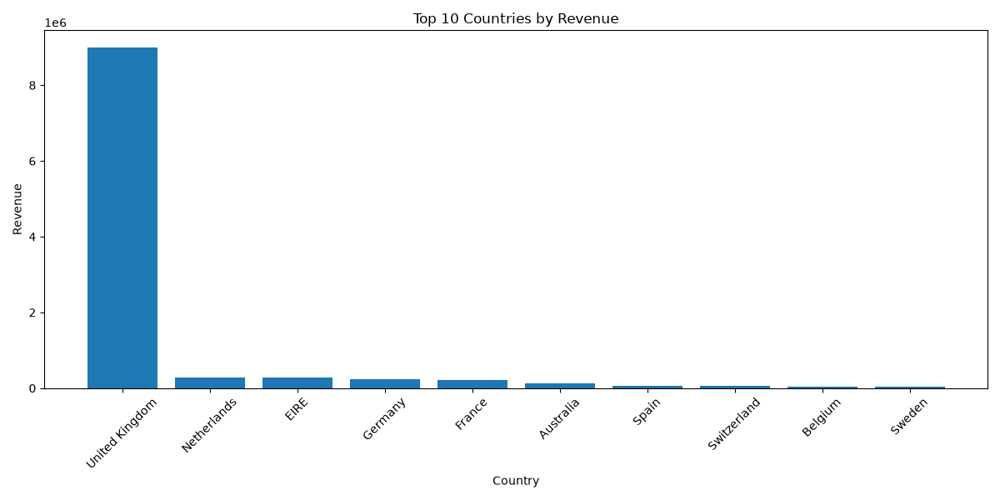
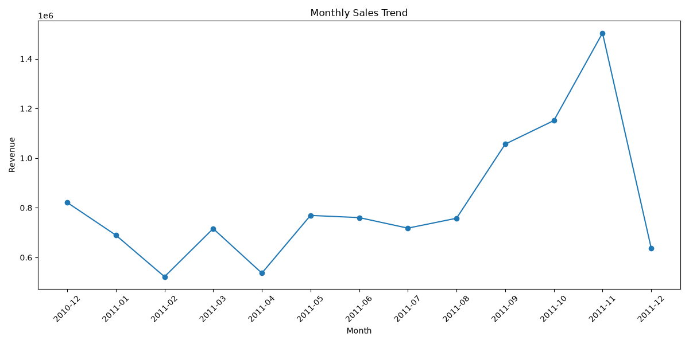
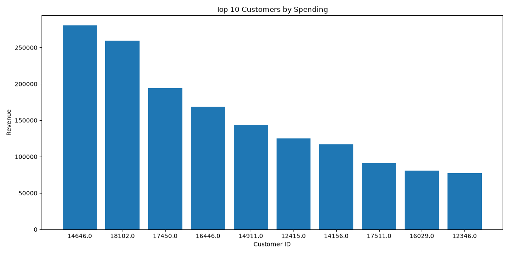
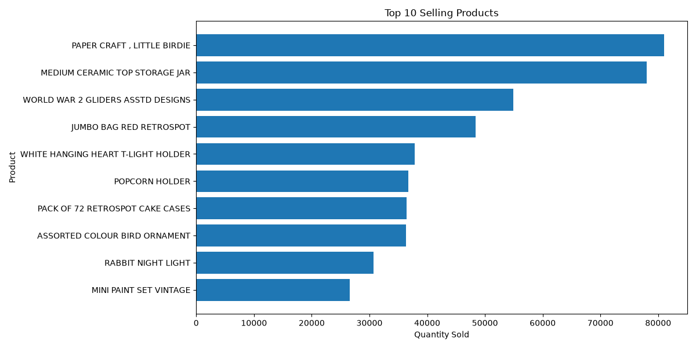

# 🛒 E-Commerce Sales Analysis Using PySpark

An end-to-end Big Data Analytics project that analyzes e-commerce transaction data using **Apache PySpark, Python, Pandas, and Streamlit**.

The project processes retail transaction records, cleans the data, performs sales analysis, generates visualizations, and presents key business insights through an interactive dashboard.

## 🚀 Project Overview

The objective of this project is to analyze e-commerce sales data and identify useful business insights, including:

- Total revenue and order performance
- Customer purchasing behavior
- Best-selling products
- Country-wise sales performance
- Monthly revenue trends
- Average order value

## 🛠️ Technologies Used

| Technology | Purpose |
|---|---|
| Python | Programming |
| Apache PySpark | Big Data processing |
| Pandas | Data handling |
| Matplotlib | Data visualization |
| Plotly | Interactive charts |
| Streamlit | Interactive dashboard |
| Jupyter Notebook | Data exploration |

## 📊 Project Workflow

1. Dataset collection
2. Data loading using PySpark
3. Data cleaning and preprocessing
4. Sales analysis using PySpark DataFrames
5. SQL-based analysis using Spark SQL
6. Data visualization
7. Interactive dashboard development

## 📈 Output Visualizations

### 1. Country-wise Sales Analysis



### 2. Monthly Sales Analysis



### 3. Top Customers Analysis



### 4. Top Products Analysis



## 📁 Project Structure

```text
Ecommerce-Sales-Analysis/
│
├── dataset/
│
├── dashboard/
│   └── app.py
│
├── notebooks/
│
├── src/
│   ├── spark_session.py
│   ├── convert_dataset.py
│   ├── data_loader.py
│   ├── data_cleaning.py
│   ├── sales_analysis.py
│   ├── spark_sql_analysis.py
│   └── visualizations.py
│
├── outputs/
│   ├── charts/
│   │   ├── country_sales.png
│   │   ├── monthly_sales.png
│   │   ├── top_customers.png
│   │   └── top_products.png
│   └── cleaned_data/
│
├── .gitignore
└── README.md
```

## 📂 Dataset

This project uses the **Online Retail Dataset** from the UCI Machine Learning Repository.

Dataset: https://archive.ics.uci.edu/dataset/352/online+retail

Download the dataset and place the Excel file inside the `dataset/` directory.

The dataset is converted into CSV format before being processed using PySpark.

## ⚙️ Installation and Setup

### 1. Clone the repository

```bash
git clone https://github.com/dhanush080607/Ecommerce-Sales-Analysis.git
cd Ecommerce-Sales-Analysis
```

### 2. Create a virtual environment

```bash
python3 -m venv .venv
source .venv/bin/activate
```

### 3. Install dependencies

```bash
python -m pip install --upgrade pip
python -m pip install pyspark pandas matplotlib plotly streamlit openpyxl
```

### 4. Download the dataset

Download the Online Retail dataset from the UCI repository and place it inside `dataset/`.

### 5. Run the project

Run the Python scripts from the project root directory:

```bash
python src/convert_dataset.py
python src/data_loader.py
python src/data_cleaning.py
python src/sales_analysis.py
python src/spark_sql_analysis.py
python src/visualizations.py
```

### 6. Launch the dashboard

```bash
streamlit run dashboard/app.py
```

The interactive dashboard will open in your browser.

## 🎯 Key Features

- Large-scale transaction data processing using PySpark
- Data cleaning and preprocessing
- Sales analysis using Spark DataFrames
- SQL queries using Spark SQL
- Revenue and customer analysis
- Static data visualizations
- Interactive Streamlit dashboard

## 👨‍💻 Author

**Faheed**

- GitHub: [https://github.com/FaheedBasha123](https://github.com/FaheedBasha123/)
- LinkedIn: [https://linkedin.com/in/shaik-faheed-basha-64b378320](https://www.linkedin.com/in/shaik-faheed-basha-64b378320/)

---

⭐ If you find this project interesting, consider giving it a star!
